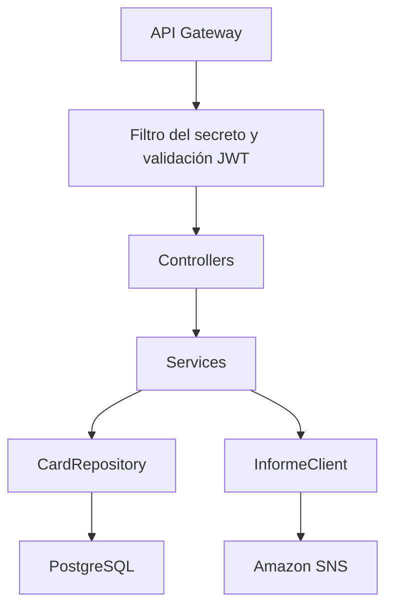

```
⠸⣷⣦⠤⡀⠀⠀⠀⠀⠀⠀⠀⠀⠀⠀⠀⠀⠀⠀⠀⠀⠀⠀⢀⣀⣠⣤⠀⠀⠀
⠀⠙⣿⡄⠈⠑⢄⠀⠀⠀⠀⠀⠀⠀⠀⠀⠀⠀⠀⠀⣀⠔⠊⠉⣿⡿⠁⠀⠀⠀
⠀⠀⠈⠣⡀⠀⠀⠑⢄⠀⠀⠀⠀⠀⠀⠀⠀⠀⡠⠊⠁⠀⠀⣰⠟⠀⠀⠀⣀⣀
⠀⠀⠀⠀⠈⠢⣄⠀⡈⠒⠊⠉⠁⠀⠈⠉⠑⠚⠀⠀⣀⠔⢊⣠⠤⠒⠊⠉⠀⡜
⠀⠀⠀⠀⠀⠀⠀⡽⠁⠀⠀⠀⠀⠀⠀⠀⠀⠀⠀⠩⡔⠊⠁⠀⠀⠀⠀⠀⠀⠇
⠀⠀⠀⠀⠀⠀⠀⡇⢠⡤⢄⠀⠀⠀⠀⠀⡠⢤⣄⠀⡇⠀⠀⠀⠀⠀⠀⠀⢰⠀
⠀⠀⠀⠀⠀⠀⢀⠇⠹⠿⠟⠀⠀⠤⠀⠀⠻⠿⠟⠀⣇⠀⠀⡀⠠⠄⠒⠊⠁⠀
⠀⠀⠀⠀⠀⠀⢸⣿⣿⡆⠀⠰⠤⠖⠦⠴⠀⢀⣶⣿⣿⠀⠙⢄⠀⠀⠀⠀⠀⠀
⠀⠀⠀⠀⠀⠀⠀⢻⣿⠃⠀⠀⠀⠀⠀⠀⠀⠈⠿⡿⠛⢄⠀⠀⠱⣄⠀⠀⠀⠀
⠀⠀⠀⠀⠀⠀⠀⢸⠈⠓⠦⠀⣀⣀⣀⠀⡠⠴⠊⠹⡞⣁⠤⠒⠉⠀⠀⠀⠀⠀
⠀⠀⠀⠀⠀⠀⣠⠃⠀⠀⠀⠀⡌⠉⠉⡤⠀⠀⠀⠀⢻⠿⠆⠀⠀⠀⠀⠀⠀⠀
⠀⠀⠀⠀⠀⠰⠁⡀⠀⠀⠀⠀⢸⠀⢰⠃⠀⠀⠀⢠⠀⢣⠀⠀⠀⠀⠀⠀⠀⠀
⠀⠀⠀⢶⣗⠧⡀⢳⠀⠀⠀⠀⢸⣀⣸⠀⠀⠀⢀⡜⠀⣸⢤⣶⠀⠀⠀⠀⠀⠀
⠀⠀⠀⠈⠻⣿⣦⣈⣧⡀⠀⠀⢸⣿⣿⠀⠀⢀⣼⡀⣨⣿⡿⠁⠀⠀⠀⠀⠀⠀
⠀⠀⠀⠀⠀⠈⠻⠿⠿⠓⠄⠤⠘⠉⠙⠤⢀⠾⠿⣿⠟⠋
```
TCGstore — Backend for Frontend (BFF)
API REST de TCGstore desarrollada con Java y Spring Boot. Administra el catálogo de cartas en PostgreSQL, valida JWT de Cognito y publica solicitudes de informes en Amazon SNS.
Arquitectura
El navegador llama al frontend y este consume el API Gateway. El Gateway dirige las solicitudes al BFF, que accede a PostgreSQL en Supabase y publica eventos en SNS. Las colas y Lambdas procesan los informes de forma asíncrona. Esta es la integración prevista; debe verificarse para cada despliegue.
Tecnologías y requisitos
- Java 21 y Gradle Wrapper incluido.
- Spring Boot 4.1.1, Spring Security, OAuth2 Resource Server y Spring Data JPA.
- PostgreSQL, AWS SDK para SNS y Docker para despliegue.
- Base de datos, Cognito, secreto compartido y SNS configurados según el ambiente.
Variables de entorno
Variable	Propósito
DB_URL	URL JDBC PostgreSQL, por ejemplo jdbc:postgresql://<host>:5432/postgres.
DB_USER	Usuario de base de datos.
DB_PASSWORD	Contraseña de base de datos.
COGNITO_ISSUER_URI	Issuer del User Pool de Cognito.
COGNITO_CLIENT_ID	Identificador del cliente esperado.
API_GATEWAY_SECRET	Valor esperado en X-Secret-Gateway.
SNS_TOPIC_ARN	ARN del topic para publicar solicitudes de informe.
AWS_REGION	Región AWS para el SDK.
PORT	Puerto HTTP; por defecto 8080.


Usa credenciales AWS temporales o un rol con permiso sns:Publish para el topic correspondiente. El SDK usa la cadena de credenciales habitual. SNS_TOPIC_ARN tiene valor vacío por defecto, pero se necesita un topic válido para publicar informes.

No guardes contraseñas, tokens ni claves en el repositorio. Para ejecutar en local, define las variables en la sesión de PowerShell o en la configuración de ejecución del IDE. El secreto compartido lo agrega el Gateway; no debe estar en el frontend.
Compilación y ejecución
En PowerShell, desde la raíz:
.\gradlew.bat clean test
.\gradlew.bat bootJar
.\gradlew.bat bootRun
bootRun requiere las variables y servicios correspondientes. Los tests usan su configuración propia; un build exitoso no sustituye una prueba de conexión real con Cognito, la base de datos y SNS.

El proyecto incluye Dockerfile y un workflow de GitHub Actions. Antes de desplegar, revisa sus variables, secretos y destinos: el workflow proporcionado se activa para main y utiliza configuración específica de EC2 y la base de datos.
API y permisos
Método	Ruta	Acceso
GET	/api/cards, /api/cards/{id}	Usuario autenticado.
POST	/api/cards	Admin o Colaborador.
PUT / PATCH	/api/cards/{id}	Admin o Colaborador.
DELETE	/api/cards/{id}	Admin.
POST	/api/informes/generar	Admin.
GET	/api/health	Autenticación requerida en esta configuración.


Las peticiones protegidas pasan por Spring Security y el filtro de X-Secret-Gateway; la configuración permite peticiones OPTIONS para CORS. Revisa la configuración efectiva del proxy y Gateway para suministrar la cabecera y permitir los orígenes necesarios.

El decoder valida firma mediante las claves del issuer, expiración, issuer y cliente esperado a través de aud o client_id; los grupos de Cognito se convierten en roles. Coordina el tipo de token y scopes entre frontend, Gateway y BFF: la validación de cliente no equivale por sí sola a validar scopes.
Informes
POST /api/informes/generar acepta un cuerpo opcional con reportType y params. El servidor obtiene la identidad desde el JWT, crea un requestId y publica un evento report.requested en SNS. Ante una publicación correcta responde:
{"informeId":"<identificador>","status":"SOLICITADO"}
El estado HTTP es 202 Accepted: solo confirma la aceptación de la solicitud. El procesamiento posterior pertenece al repositorio de Lambdas.
Estructura
- cards/: controlador, servicio, entidad, repositorio y DTOs de cartas.
- module/informes/: solicitud y publicación de eventos.
- security/ y config/: JWT, roles y filtro del Gateway.
- health/: endpoint de estado.
- src/main/resources/application.properties: configuración por variables de entorno.
- .github/workflows/deploy.yml: automatización de despliegue.
Base de datos: spring.jpa.hibernate.ddl-auto=update permite cambios automáticos de esquema al iniciar; revisa su conveniencia antes de usarlo en producción y no asumas que reemplaza migraciones y respaldos.
Diseño por capas

El controlador recibe y valida solicitudes HTTP. El servicio coordina la operación. El repositorio accede a la entidad Card mediante JPA. Los DTOs separan el contrato HTTP del modelo persistido. El módulo de informes publica el evento sin ejecutar las tareas que corresponden a las Lambdas.
Configuración local de ejemplo
Define los valores reales solo en tu entorno de ejecución. En PowerShell:
$env:DB_URL = "jdbc:postgresql://<host>:5432/postgres"
$env:DB_USER = "<usuario>"
$env:DB_PASSWORD = "<contrasena>"
$env:COGNITO_ISSUER_URI = "https://cognito-idp.<region>.amazonaws.com/<pool-id>"
$env:COGNITO_CLIENT_ID = "<client-id>"
$env:API_GATEWAY_SECRET = "<secreto-compartido>"
$env:AWS_REGION = "us-east-1"
$env:SNS_TOPIC_ARN = "arn:aws:sns:us-east-1:<cuenta>:report-events"
.\gradlew.bat bootRun
Los marcadores deben reemplazarse antes de ejecutar. Evita introducir secretos en terminales grabadas, capturas o archivos versionados. La URL JDBC de Java y DATABASE_URL de las Lambdas tienen formatos diferentes aunque apunten a la misma base de datos.
Linux y macOS
chmod +x gradlew
./gradlew clean test bootJar
./gradlew bootRun
Para ejecutar el JAR generado, utiliza su nombre real dentro de build/libs/. El proceso debe recibir las mismas variables de configuración.
Contrato de cartas
Campos de creación/actualización:
Campo	Tipo	Uso
name	string	Nombre.
game	string	Juego.
setName	string	Edición.
rarity	string	Rareza.
condition	string	Estado físico.
price	number	Precio.
stock	integer	Existencias.
imageUrl	string	URL de imagen.


Ejemplo de cuerpo para POST o PUT:
{
  "name": "Carta de ejemplo",
  "game": "Pokémon",
  "setName": "Edición de ejemplo",
  "rarity": "Secreta",
  "condition": "Near Mint",
  "price": 100,
  "stock": 3,
  "imageUrl": "https://example.com/carta.png"
}
POST y PUT emplean el grupo de validación OnWrite; PATCH usa la validación predeterminada y permite actualización parcial. Los grupos de Bean Validation afectan qué restricciones se ejecutan: no debe asumirse que todas las anotaciones del DTO se aplican en todos los métodos. El ID no se toma del cuerpo de creación.
Respuestas
- Creación: 201 Created.
- Lectura y actualización correctas: 200 OK.
- Eliminación correcta: 204 No Content.
- Carta no encontrada en operaciones por ID: 404 Not Found.
- Validación de cuerpo rechazada: normalmente 400 Bad Request.
- JWT rechazado o ausente: normalmente 401 Unauthorized, si se superó el filtro de secreto.
- Secreto ausente/incorrecto o permisos de rol insuficientes: 403 Forbidden.
El orden de los filtros importa: una llamada directa sin secreto puede recibir 403 antes de que se compruebe el JWT.
Contrato del evento de informe
Ejemplo ilustrativo del mensaje publicado en SNS:
{
  "type": "report.requested",
  "body": {
    "requestId": "identificador-unico",
    "requester": "usuario@example.com",
    "requesterId": "sub-de-cognito",
    "reportType": "top-products",
    "params": {},
    "requestedAt": "2026-10-27T12:00:00Z"
  }
}
requester se toma del claim email o, si falta, del sub. requesterId conserva el sub. El tipo predeterminado es top-products. El cliente no puede escoger otra identidad mediante el cuerpo de la petición. Aceptar un valor reportType no implica que las Lambdas implementen todos los tipos posibles.
Salud y diagnóstico
GET /api/health intenta obtener una conexión y validarla. Responde UP si funciona y 503 con estado DOWN si la conexión falla. Los detalles internos se escriben en logs, no en el mensaje de error de la base enviado al cliente. No es una prueba de SNS ni una verificación completa de todos los servicios.

Para una prueba directa local desde PowerShell, con valores temporales configurados:
$headers = @{
  Authorization = "Bearer <token-de-prueba>"
  "X-Secret-Gateway" = $env:API_GATEWAY_SECRET
}
Invoke-RestMethod -Uri "http://localhost:8080/api/health" -Headers $headers
En peticiones por API Gateway, la cabecera secreta la debe incorporar el Gateway. El filtro del secreto también se aplica a OPTIONS: es conveniente que el Gateway responda los preflight de CORS sin enviarlos al BFF.
Docker y entrega continua
El Dockerfile utiliza Temurin 21 JRE, copia el JAR previamente compilado y ejecuta Java con usuario sin privilegios. Aunque declara EXPOSE 80, el puerto efectivo de Spring es el definido por PORT o 8080: EXPOSE no cambia el puerto del proceso.
.\gradlew.bat bootJar
docker build -t tcgstore-bff .
Para iniciar el contenedor, pasa las variables de configuración mediante un mecanismo local seguro y publica el puerto del proceso. El workflow proporcionado usa 80:8080 en EC2 y define PORT=8080.
Configuración requerida en GitHub Actions
Tipo	Nombre
Variable	TARGET_HOST_IP
Variable	COGNITO_ISSUER_URI
Variable	COGNITO_CLIENT_ID
Variable	SNS_TOPIC_ARN
Secret	EC2_SSH_KEY
Secret	API_GATEWAY_SECRET
Secret	SUPABASE_DB_USER
Secret	SUPABASE_DB_PASSWORD
Secret	GH_CR_PAT


GITHUB_TOKEN se utiliza para publicar la imagen desde Actions. GH_CR_PAT se usa para descargarla en EC2. El workflow contiene el nombre de imagen vicente-palacios/tcgstore, un host de Supabase fijo y región us-east-1: adáptalos si despliegas desde un fork. También espera Amazon Linux y ec2-user.

El build del workflow ejecuta bootJar -x test, por lo que no ejecuta los tests. Un resultado verde de despliegue no reemplaza la ejecución de pruebas ni la verificación funcional. El rol de EC2 debe permitir la publicación en el topic; no es necesario incluir claves AWS estáticas en la imagen.
Verificación y problemas frecuentes
Situación	Revisión
La aplicación no inicia	Variables obligatorias, Java 21 y acceso a PostgreSQL.
403 antes de validar JWT	Cabecera y secreto del Gateway.
401 con secreto correcto	Expiración, firma, issuer y cliente del JWT.
403 con autenticación válida	Grupos y reglas @PreAuthorize.
Error al solicitar informe	ARN, región, credenciales/rol y permiso SNS.
API Gateway falla al integrar	Destino EC2, puerto, disponibilidad y configuración de red.
Workflow falla en un fork	Imagen GHCR, permisos del paquete, variables y secrets propios.


Prueba con Admin, Colaborador y Cliente; conserva evidencias de 200/201/204, 401/403 y 202 según la operación. Ejecuta además AudienceValidatorTest para validar el comportamiento del cliente esperado. Verifica el flujo de informes en las Lambdas usando el identificador de solicitud.


flowchart TD
    U["Usuario en el navegador"] --> V["React alojado en Vercel"]
    V <-->|"Iniciar sesión"| C["Amazon Cognito"]
    V -->|"Petición + JWT"| G["API Gateway"]
    G -->|"JWT válido + cabecera secreta"| B["BFF Spring Boot en EC2"]

    B <-->|"Consultar y modificar cards"| DB["Supabase · PostgreSQL"]
    B -->|"Publica report.requested"| SNS["Amazon SNS"]
    B -->|"Responde 202 + informeId"| V

    SNS --> Q1["SQS · solicitudes"]
    SNS --> Q2["SQS · informes"]
    SNS --> Q3["SQS · stock"]
    SNS --> Q4["SQS · correos"]

    Q1 --> L1["Lambda recorder"]
    Q2 --> L2["Lambda generator"]
    Q3 --> L3["Lambda stock-alert"]
    Q4 --> L4["Lambda mailer"]

    L1 -->|"Guarda report_requests"| DB
    L2 -->|"Lee top 10 de cards"| DB
    L3 -->|"Lee stock de cards"| DB
    L4 -->|"Lee cartas Secretas"| DB

    L2 --> A["API externa de avisos"]
    L3 --> A
    L4 --> E["API externa de correo"]


